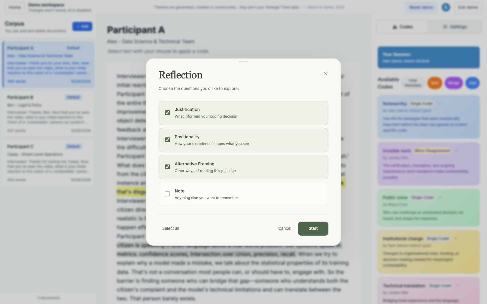

# Reflexis

Reflexis is a research prototype for collaborative qualitative analysis. It helps a coding team see where their interpretations differ, and why, so those differences can be discussed rather than smoothed over.

It accompanies the CHI 2026 paper [Reflexis: Supporting Reflexivity and Rigour in Collaborative Qualitative Analysis through Design for Deliberation](https://doi.org/10.1145/3772318.3791275).



## Features

- **Positionality profiles.** Each researcher records their background and initial view of the data, visible to the team while coding.
- **Shared coding.** The team codes the same documents, and overlapping highlights show where researchers agree or differ.
- **Living codebook.** Each code's definition, applied passages, reflexive notes and disagreements are in one place, with a history of edits, merges and splits.
- **Reflection prompts.** When applying a code, researchers can note what informed it, how their experience shapes it, and other ways to read the passage.
- **Optional AI support.** Discussion prompts where codes differ, summaries of reflexive notes, and alerts when a new use of a code drifts from its definition.

## Try the demo

Open `/demo` on a running instance (locally, http://localhost:3000/demo). No account is needed. It loads sample interviews, fictional researchers, codes, reflections and code history. Changes stay in your browser tab and are discarded when you refresh.

AI features are off in the demo unless you add your own OpenAI API key under **Settings**. The key is kept only in that tab's memory, used only for your AI requests, and billed to your OpenAI account.

## Run locally

You need Node.js and a Firebase project with email/password Authentication and Firestore enabled.

```bash
npm install
cp .env.example .env.local   # add your Firebase config, and OPENAI_API_KEY for AI features
npm run dev
```

Run the tests with `npm test`. Firestore security rules are in `firestore.rules`. For a step-by-step guide to using the app, see [docs/first-time-user-infographic.md](docs/first-time-user-infographic.md).

## Data and privacy

Project data (profiles, documents, codes, highlights and reflections) is stored in Firestore, and access is limited to project members. AI features send relevant excerpts, such as selected passages, code definitions, positionality text or reflexive notes, to the OpenAI API. They can be turned off in **Settings**.

Reflexis is a research prototype, not a supported product. Check your institution's ethics, consent and data requirements before using it with participant data.

## Citation

```bibtex
@inproceedings{ye2026reflexis,
  title={Reflexis: Supporting Reflexivity and Rigour in Collaborative Qualitative Analysis through Design for Deliberation},
  author={Ye, Runlong and Huang, Oliver and Yung Kang Lee, Patrick and Liut, Michael and Nobre, Carolina and Kong, Ha-Kyung},
  booktitle={Proceedings of the 2026 CHI Conference on Human Factors in Computing Systems},
  pages={1--31},
  year={2026}
}
```
